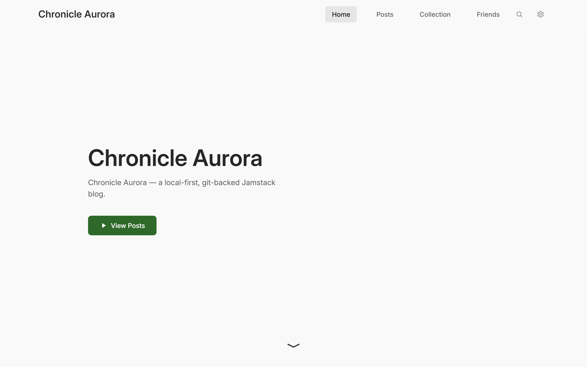
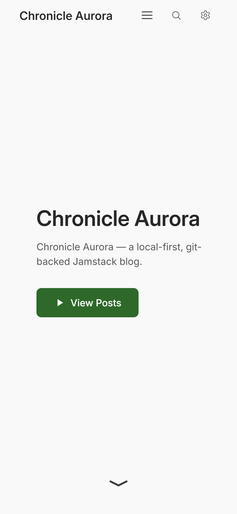

# Chronicle Aurora

[](CHANGELOG.md)

[中文](README.zh.md) English

**Live demo:** [chr.eightyfor.top](https://chr.eightyfor.top) — built from the `demo` branch of this repository. Your copy starts empty: `data/` ships schema defaults and no posts.

A Jamstack blog template. Clone and go — Markdown + YAML content, Git version control, one-command deploy to static CDN. Local-first: no database, no API server, no runtime.

Content is YAML + Markdown on the filesystem. [Astro](https://astro.build) SSG → static HTML. `git push` → CI → CDN.

## Features

<p align="center">
  
  
</p>

- **Static by default** — every page pre-rendered at build time. Fast, SEO-friendly, low client-side JS required for reading.
- **Markdown + frontmatter** — write posts in Markdown with YAML metadata. Familiar workflow, clean git diffs.
- **Dark / light theme** — color system derived from 3 foundation tokens. Toggle via UI or follow system preference.
- **i18n out of the box** — Chinese and English routes (`/zh/`, `/en/`). Add more languages by adding translation files.
- **Collection groups** — organize posts into curated guides or series with built-in navigation.
- **Friends / blogroll** — showcase other sites with avatars, descriptions, and links.
- **Marp slides** — turn any post into a presentation. Markdown → slide deck with themes and transitions.
- **Built-in search** — client-side full-text search across all blog posts.
- **Comments** — support for Staticman, GitHub Issues, Twikoo, or disable entirely. New comments land in a pending folder for review.
- **RSS feed** — auto-generated, always up to date.
- **Responsive layout** — readable on phones, tablets, and desktops.
- **Image pipeline** — drop images into `data/` directories. Auto-compressed to WebP/AVIF at build time.

## Structure

```
data/                        — Your content: posts, images, config. The single source of truth.
packages/template-astro/     — Astro frontend: the rendering layer (theme + presets + feature plugins)
packages/gen/                — Build orchestration: rebuild index → render → atomic sync
packages/manager/            — Content manager (local-first CMS)
packages/shared/             — Shared types & utilities
.github/assets/              — README screenshots (not part of your site)
demo/                        — demo content, fetched from the `demo` branch and git-ignored
.chronicle/                  — local CMS state, generated on first launch and git-ignored
```

## Architecture

**Identity:** `template-astro` is a PaperMod-style, content-agnostic rendering layer. Heavy features (comments / search / Marp slides / collections / friends) are optional capabilities registered through an open abstraction layer — a light theme by default, growing heavy features only when a content source enables them. `data/` + `gen` + `manager` are the official reference implementation around it.

Four layers:

```
主板 (core framework)   — data contract + page skeleton + render loop. Presets only.
可插拔功能 (plugins)    — collections/friends/search/comments/Marp, registered via manifest
主题 (theme)            — ALL styles (tokens / global / critical / component). Swappable.
manager                 — templated CMS: reads a template manifest, not hardwired to this repo
```

## Quick Start

```bash
# 1. Create your copy from this template, then clone it
#    GitHub → "Use this template" → your new repository
git clone https://github.com/<your-username>/<your-repo>.git
cd <your-repo>

# 2. Install dependencies (npm workspaces — one command installs all packages)
npm run init

# 3. Start the dev servers (from the repo root)
npm run dev:astro       # blog template → http://localhost:4321
npm run dev:cms         # content manager, browser mode → http://localhost:5173

# 4. Build for production (SSG → dist/)
npm run build:astro

# 5. Preview the production build (serves dist/)
npm run preview

# 6. Stop processes occupying dev ports (5173 CMS / 4321 Astro)
npm run stop
```

## Make it yours

Your copy is already clean: `data/` holds schema defaults and no posts, `.chronicle/` is generated on first launch, and the demo content lives on this repository's `demo` branch (never copied into your repo).

Want to look at the demo locally first? It is one command per branch — content fetched into the git-ignored `demo/` directory, code always from your branch:

```bash
npm run demo:fetch   # pull the demo content into demo/
npm run dev:demo     # dev server rendering the demo site → http://localhost:4321
npm run preview:demo # after `npm run build:demo`
```

Then write your own site:

```bash
npm run dev:astro    # http://localhost:4321 — your (empty) site
```

The reset commands stay useful once you have been editing (all accept `--dry-run`, e.g. `npm run reset:data -- --dry-run`):

| Command | Effect |
|---|---|
| `npm run reset:site` | Template settings → schema defaults: `data/site.yml` (home page, appearance, post page), `data/profile.yml`, `data/friends.yml`, `data/collections.yml`, `data/background/background.yml`. Hand-written comments in those files survive. |
| `npm run reset:cms` | CMS state → defaults: `.chronicle/workspace.json` (backend theme, accent, locale, background meta). |
| `npm run reset:data` | Deletes content: posts, comments, pending comments, assets, avatar, background media, about page. Keeps the directories and the YAML settings files. |
| `npm run init:clean` | The three above, in that order — back to the "fresh blog" state. |
| `npm run migrate -- <data.tar.gz>` | Imports a pre-Aurora (legacy) `data/` archive: posts, attachments, assets, about page, plus config JSON → YAML. Backs up to `data.bak/` first; needs `tar`. |

> Everything a reset touches is tracked by git: commit first, review with `git status` / `git diff`, and roll the whole thing back with `git checkout -- data .chronicle` if you don't like the result.

Then make it yours:

1. **`data/site.yml`** — site name, description, accent colour, home page mode, and the per-plugin sections (`search`, `comments`, `friends`, `collections`, `slides`, `reading-experience`, `ai-enhance`).
2. **`data/profile.yml`** — author name, bio, links. Avatars go in `data/avatar/` (auto-discovered).
3. **`SITE_URL`** — one repository variable (Settings → Variables) or a root Pages repo; it feeds RSS, `sitemap.xml` and `robots.txt`. See [Deployment](#deployment).
4. **Brand assets** — `npm run assets` regenerates the default social card (`public/branding/og-default.png`), the favicon set and `site.webmanifest` from the site name, description and accent colour in `data/site.yml`. To use your own icons, drop `favicon.svg` / `favicon-32.png` / `favicon.ico` / `apple-touch-icon.png` / `icon-192.png` / `icon-512.png` into `data/branding/` (directory as setting, like avatars), or enable **Use Avatar as Icon** in the appearance settings to use `data/avatar/`. Explicit files win over the avatar.
5. **Write posts** — `data/posts/<slug>/index.md` with YAML frontmatter, or use the CMS (`npm run dev:cms`). Add `image: /assets/cover.jpg` (or an absolute URL) for the post's social-preview card; it also upgrades `twitter:card` to `summary_large_image`.
6. **Commit and push** — CI builds and deploys.

## Markdown

The renderer covers CommonMark plus the extensions below. The demo post *Markdown Showcase* shows most of these live, and `npm run check:markdown` keeps the build-time and editor renderers in sync.

**Text and blocks**

| Syntax | Result |
|:--|:--|
| `## Heading` | Headings; ids preserve case (`## Section two` → `#Section-two`) and feed the table of contents |
| `**bold**` · `*italic*` · `~~struck~~` · `` `code` `` | Emphasis, strikethrough, inline code |
| `- item` · `1. item` · `- [x] done` | Lists and task lists |
| `\| a \| b \|` | Tables |
| `> quote` | Blockquote — 2px rail, secondary text, no box |
| `> [!NOTE]` · `[!TIP]` · `[!IMPORTANT]` · `[!WARNING]` · `[!CAUTION]` | Alert with a title line; give it your own: `> [!WARNING] Careful` |
| `---` | Horizontal rule |
| `<details><summary>…</summary>…</details>` | Collapsible section |
| `text[^1]` + `[^1]: note` | Footnotes |
| `$x^2$` · `$$ … $$` | Inline / block math (KaTeX) |
| ` ```mermaid ` | Diagram, rendered before print and export |
| `<kbd>Ctrl</kbd>` | Inline HTML passes the sanitiser whitelist |

**Images**

| Syntax | Result |
|:--|:--|
| `` | Block image; the title becomes the caption: `` |
| `` | Fixed size. `=800x` width only, `=x600` height only (the other side follows the real ratio), `=70%x` / `=x50%` relative |
| `Text  more` | Inline image — stays on the text line |
| `[](CHANGELOG.md)` | Linked image: inline, and clicking follows the link instead of opening the preview |
| `` | Shared asset from `data/assets/` |

**Links and file cards**

| Syntax | Result |
|:--|:--|
| `[report](report.pdf)` | File card (extension whitelist; `.md` renders as a plain link) |
| `[listen](audio:ep.mp3)` | Force a card type: `file:` · `audio:` · `video:` · `code:` (alias `text:`) |
| `Download the [report](report.pdf) now.` | Mini card — a card sharing a line with prose |
| `[manual](open:manual.pdf#page=3)` | Force a plain inline link instead of a card |
| `[other](post://hello-world)` | Link to another post |
| `[site](https://example.com)` | External link |
| `[top](#Section-two)` | In-page anchor (case-sensitive, as above) |

## Export and print

| Action | Output |
|:--|:--|
| Export with local assets | `<title>.zip` — `index.html` plus `image1.png`, `image2.jpg`, `attachment1.pdf`, … flat at the archive root, references rewritten |
| Export without local assets | a single `<title>.html` |
| Print | hidden fullscreen light-mode frame: file cards and internal links are not clickable, external links stay clickable in the PDF |

## Commands

Every script in the root `package.json`, in one place — `npm run` lists the names, this table says what they do. (The demo post *Getting Started* carries only the handful you type daily; this is the reference.)

**Setup and development**

| Command | What it does |
|:--|:--|
| `npm run init` | Install every workspace package (one-time setup) |
| `npm run dev:cms` | CMS in the browser → http://localhost:5173 |
| `npm run dev:astro` | Blog template with live reload → http://localhost:4321 |
| `npm run stop` | Free the dev ports (5173 / 4321) |
| `npm run typecheck` | Type-check manager / gen / shared |

**Build, preview and demo content**

| Command | What it does |
|:--|:--|
| `npm run build:astro` | SSG build → `dist/` — the deployable site |
| `npm run preview` | Serve the built `dist/` locally |
| `npm run demo:fetch` | Pull the demo content into the git-ignored `demo/` |
| `npm run dev:demo` | Dev server rendering `demo/` content |
| `npm run build:demo` | `demo:fetch` + build → `dist-demo/` |
| `npm run preview:demo` | Serve `dist-demo/` |
| `npm run demo:commit` | Commit `demo/` changes onto the `demo` branch (`--push` to publish) |

**Maintenance and upstream**

| Command | What it does |
|:--|:--|
| `npm run update` | Merge upstream framework changes, keeping `data/` and `.chronicle/` |
| `npm run reset:site` | Reset settings YAML to schema defaults |
| `npm run reset:cms` | Reset `.chronicle/` CMS state |
| `npm run reset:data` | Delete content: posts, comments, media, about page |
| `npm run init:clean` | `reset:site` + `reset:cms` + `reset:data` |
| `npm run migrate -- <data.tar.gz>` | Import a pre-Aurora `data/` archive (backs up to `data.bak/`) |
| `npm run assets` | Regenerate brand assets (social card, favicon set, manifest) |
| `npm run release` | Version bump + changelog + tag (maintainers only) |

**Checks**

| Command | What it does |
|:--|:--|
| `npm test` | Post indexer unit tests |
| `npm run test:cms` | Browser-mode CMS end-to-end (needs Chrome) |
| `npm run check:base -- --dir dist --base /repo/` | Every absolute link carries the base path |
| `npm run check:encoding` | Detect mojibake / broken encoding in sources and content |
| `npm run check:markdown` | SSG vs CMS markdown renderer parity (43-case corpus) |
| `npm run check:export` | Export packaging (ZIP layout, renaming, CRC) + print sanitisation |
| `npm run check:commands` | Fail when a `package.json` script is missing from this table |
| `npm run verify:isolation` | Collections disabled → no page/layout/index/CSS residue |
| `npm run verify:isolation:all` | Every optional plugin disabled → no residue |

**Content tools**

| Command | What it does |
|:--|:--|
| `npm run ai:summaries` | Generate AI summaries for posts (needs `ai-enhance` enabled) |
| `npm run shots` | Regenerate `demo-desktop.png` / `demo-mobile.png` |

## Checks

```bash
npm run typecheck             # manager / gen / shared
npm test                      # post indexer unit tests
npm run verify:isolation      # collections disabled → no page/layout/index/CSS residue
npm run verify:isolation:all  # every optional plugin disabled
npm run check:base -- --dir dist --base /repo/   # every absolute link carries the base path
npm run check:markdown        # SSG vs CMS markdown renderer parity (43-case corpus)
npm run check:export          # export ZIP layout + print sanitisation
npm run check:commands        # every package.json script documented
npm run test:cms              # browser-mode CMS: icon setting + avatar upload, end to end (needs Chrome)
```

`test:cms` starts its own Vite instance and headless Chrome, temporarily writes `data/avatar/` and `data/site.yml`, asserts the build output, then restores both. It needs an empty `data/avatar/` and no icon files in `data/branding/`.

## Deployment

`npm run build:astro` is the only supported build path: it rebuilds the post index, renders the template, then syncs everything into `dist/`. **`dist/` is the deployable site.** (`packages/template-astro/dist/` is gen's intermediate directory — don't deploy it.)

**`SITE_URL` is build-time config, resolved automatically.** RSS, `sitemap.xml` and the `Sitemap:` line in `robots.txt` use it for absolute links. The build reads the `SITE_URL` environment variable and falls back to `http://localhost:4321` for local dev.

CI fills it in this order:

1. repository variable `SITE_URL` (explicit override, also used for non-Pages hosts),
2. the Pages settings themselves — `actions/configure-pages` reports the public `origin`, so a custom domain or a root Pages repo needs no configuration at all,
3. repo-name fallback for `<user>.github.io`,
4. otherwise the job fails with an actionable error instead of shipping `localhost` links.

| Target | What to configure |
|---|---|
| GitHub Pages + custom domain | Nothing — CI reads the origin from Pages settings |
| GitHub Pages, root repo (`<user>.github.io`) | Nothing |
| GitHub Pages, project path (`<user>.github.io/<repo>/`) | Nothing — CI derives `SITE_URL` and `BASE_PATH` from the Pages settings |
| Netlify / Vercel | Build `npm run build:astro`, publish `dist`, env `SITE_URL=https://your.origin` |
| Self-hosted (Nginx / Caddy) | `SITE_URL=https://your.origin npm run build:astro`, then serve `dist/` |
| Any target, explicit override | Repository variables `SITE_URL` (and `BASE_PATH` for sub-path hosting) win over inference |

First deploy: Settings → Pages → Source: **GitHub Actions**. CI also fails the job if `localhost` leaks into `rss.xml` / `sitemap.xml` / `robots.txt`.

**Demo branch (upstream only).** This repository publishes its live demo from a content-only `demo` branch: CI fetches it into `demo/` and builds with `--dataDir demo`, so the demo always runs the latest `main` code and the two cannot drift. Pushing to `demo` deploys immediately (the branch carries a short trigger that calls this reusable workflow on `main`); the nightly run is only a backstop. The workflow refuses to publish if that branch is missing (so an empty site can never be deployed to the demo domain) and rejects any code that would land on it. A template-generated repo has no `demo` branch — CI then builds your own `data/`, with nothing to configure.
**Maintaining the demo (upstream).** `demo/` is a git-ignored checkout of the `demo` branch, so a normal commit does not include it:

```bash
npm run demo:fetch                        # 1. sync demo/ with the branch
# 2. edit demo/posts/<slug>/index.md and demo assets — plain Markdown and files
npm run dev:demo                          # 3. preview (optional)
npm run demo:commit -- "docs(demo): ..."  # 4. commit onto the demo branch
git push origin demo                      # 5. deploy (or pass --push to step 4)
```

Use the CMS for your own site (`data/`); demo content stays plain files so it can be reviewed like documentation. Regenerate the README screenshots (light theme, English, desktop + mobile) with `npm run shots`: it builds a light copy of the demo, serves it, and captures through Chrome DevTools so the mobile viewport is emulated properly (requires Chrome; set `CHROME=/path/to/chrome` if it is not in a standard location). `npm run demo:commit` never touches `main`'s index — it writes the commit straight onto the `demo` branch.

**Git workflow:** write content in `data/` → `git commit && git push` → CI builds and deploys `dist/`.

## Update from upstream

Downstream repos can pull framework updates without losing content. One-time setup, then one command:

```bash
git remote add upstream https://github.com/vanvanhasnophi/chronicle-aurora.git
npm run update
```

If you are upgrading from **3.0.x**, run the updater from `upstream` once. The 3.0.x checkout can carry
CRLF line endings on Windows, and its copy of the script predates the branches/branch detection this
release needs:

```bash
git fetch upstream
git -c core.autocrlf=false show upstream/main:scripts/update-app.sh > /tmp/update-app.sh
bash /tmp/update-app.sh
```

The `upstream` remote is required — only a remote literally named `upstream` is used. Your `origin` points at your own copy (template-generated repos and forks both keep the `chronicle-aurora` name), so falling back to it would only ever compare the repo against itself. If `upstream` is missing, `npm run update` stops and prints the command to add it.

`npm run update` (needs bash: macOS / Linux, WSL, or Git Bash on Windows):

1. backs up `data/` and `.chronicle/`,
2. merges `upstream/main` with `-X theirs`,
3. restores both directories from the backup, then amends the merge commit.

So **`data/` and `.chronicle/` are yours** — upstream never overwrites them.

| Path | Owner | What that means |
|---|---|---|
| `data/` | you | content and settings; `npm run update` never touches it |
| `.chronicle/` | you (untracked) | local CMS state, regenerated from the settings schema |
| `packages/`, `scripts/`, root configs | upstream | edits you make here can be overwritten when upstream touches the same file |
| `packages/template-astro/src/themes/` | upstream for now | the theme is not a protected directory yet — keep colour/typography changes in `data/` until it is |

Commit or stash your own non-`data/` edits before running it — the script asks for confirmation when it finds any. When the update finishes it prints the `git log` command that lists exactly what upstream changed (there is no CHANGELOG yet, so that list is the changelog).

## Optional AI (BYOK)

AI enhancement is optional and **disabled by default**. This repository does not include an API key, model access, generated summaries, or translation credits. If you enable it, you supply your own OpenAI-compatible endpoint and key at build time:

```bash
AI_API_KEY=... AI_MODEL=... npm run ai:summaries
```

No AI request is made at runtime, and no key is exposed to site visitors.

## License

MIT
