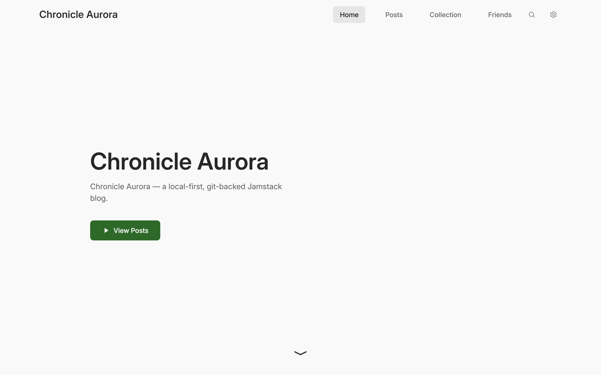

# Chronicle Aurora

[](CHANGELOG.md)

中文 [English](README.md)

**在线演示：** [chr.eightyfor.top](https://chr.eightyfor.top) —— 由本仓库的 `demo` 分支构建。你的拷贝开箱是空的：`data/` 只有 schema 默认值，没有文章。

Jamstack 博客模板。克隆即用——Markdown + YAML 内容管理、Git 版本控制、一键部署静态站点。本地优先：无数据库、无 API 服务、无运行时。

内容以 YAML + Markdown 存储在文件系统中。[Astro](https://astro.build) 静态生成 → 纯 HTML。`git push` → CI → CDN。

## 模板特色

<p align="center">
  
  
</p>

- **默认纯静态** — 所有页面在构建时预渲染。快速、SEO 友好，低客户端 JS。
- **Markdown + frontmatter** — 用 Markdown 写作，YAML 管理元数据。熟悉的写作体验，清晰的 git diff。
- **深色/浅色主题** — 从 3 个基础 token 派生的颜色系统。支持 UI 切换或跟随系统偏好。
- **国际化开箱即用** — 中英文路由（`/zh/`、`/en/`）。添加翻译文件即可扩展更多语言。
- **合集分组** — 将文章组织为精选指南或系列，内置导航。
- **友链/博客名录** — 展示其他站点，带头像、描述和链接。
- **Marp 幻灯片** — 将任意文章转为演示文稿。Markdown → 幻灯片，支持主题和过渡动画。
- **内置搜索** — 客户端全文搜索全部博客文章。
- **评论系统** — 支持 Staticman、GitHub Issues、Twikoo，或完全关闭。新评论存入待审核目录。
- **RSS 订阅** — 自动生成，始终保持最新。
- **响应式布局** — 在手机、平板和桌面端均可阅读。
- **图片管线** — 将图片放入 `data/` 对应目录，构建时自动压缩为 WebP/AVIF。

## 目录结构

```
data/                        — 你的内容：文章、图片、配置。唯一数据源。
packages/template-astro/     — Astro 前端：渲染层（主题 + 预设 + 功能插件）
packages/gen/                — 构建编排：重建索引 → 渲染 → 原子同步
packages/manager/            — 内容管理（本地优先 CMS）
packages/shared/             — 共享类型与工具
.github/assets/              — README 截图（不属于你的站点）
demo/                        — 演示内容，从 `demo` 分支取来，已被 gitignore
.chronicle/                  — 本地 CMS 状态，首次启动生成，已被 gitignore
```

## 架构

**定位：** `template-astro` 是 PaperMod 式、**内容无关的渲染层**。重功能（评论/搜索/Marp 幻灯片/合集/友链）是通过开放抽象层注册的**可选能力**——默认是轻主题，内容源启用后才长出重功能。`data/` + `gen` + `manager` 是围绕它的官方参考实现。

四层结构：

```
主板（内容框架）   — 数据契约 + 页面骨架 + 渲染循环。只提供预设。
可插拔功能（插件） — collections/friends/search/comments/Marp，经 manifest 注册
主题               — 全部样式（tokens/global/critical/组件样式）归主题，可整体更换
manager            — 模板化 CMS：读"模板清单"适配，不绑死本仓库
```

## 快速开始

```bash
# 1. 用本模板建自己的仓库，再克隆到本地
#    GitHub → “Use this template” → 你的新仓库
git clone https://github.com/<你的用户名>/<你的仓库名>.git
cd <你的仓库名>

# 2. 安装依赖（npm workspaces——一条命令安装全部包）
npm run init

# 3. 启动开发服务器（仓库根目录执行）
npm run dev:astro       # 博客模板 → http://localhost:4321
npm run dev:cms         # 内容管理（浏览器模式）→ http://localhost:5173

# 4. 构建生产版本（SSG → dist/）
npm run build:astro

# 5. 本地预览生产版本（服务 dist/）
npm run preview

# 6. 停止占用开发端口的进程（5173 CMS / 4321 Astro）
npm run stop
```

## 开始使用

你的拷贝开箱就是干净的：`data/` 只有 schema 默认值、没有文章，`.chronicle/` 首次启动时生成，演示内容放在本仓库的 `demo` 分支上（不会被拷进你的仓库）。

想先在本地看演示站：内容取到被 gitignore 的 `demo/`，代码始终来自你的分支 ——

```bash
npm run demo:fetch   # 把演示内容取到 demo/
npm run dev:demo     # 用演示内容起开发服务器 → http://localhost:4321
npm run preview:demo # 先 npm run build:demo 之后再预览
```

然后写你自己的站：

```bash
npm run dev:astro    # http://localhost:4321 —— 你自己的（空）站
```

reset 命令在改过内容之后仍然有用（都支持 `--dry-run`，如 `npm run reset:data -- --dry-run`）：

| 命令 | 作用 |
|---|---|
| `npm run reset:site` | 模板设置 → schema 默认值：`data/site.yml`（首页 / 外观 / 文章页）、`data/profile.yml`、`data/friends.yml`、`data/collections.yml`、`data/background/background.yml`。文件里的手写注释保留。 |
| `npm run reset:cms` | CMS 配置 → 默认值：`.chronicle/workspace.json`（后台主题、强调色、语言、背景 meta）。 |
| `npm run reset:data` | 删除内容：文章、评论、待审评论、媒体、头像、背景图片/视频、关于页。目录与 yml 设置文件保留。 |
| `npm run init:clean` | 依次执行上面三步 —— 全新博客状态。 |
| `npm run migrate -- <data.tar.gz>` | 导入 Aurora 之前的旧版 `data/` 归档：文章、附件、媒体、关于页，配置 JSON → YAML。会先备份到 `data.bak/`；需要 `tar`。 |

> 被重置的文件都在 git 里：先 `git commit`，跑完看 `git status` / `git diff` 复核，不满意 `git checkout -- data .chronicle` 就能整体回滚。

然后改成你自己的内容：

1. **`data/site.yml`** — 站点名、描述、强调色、首页模式，以及各插件段（`search`、`comments`、`friends`、`collections`、`slides`、`reading-experience`、`ai-enhance`）。
2. **`data/profile.yml`** — 作者名、简介、链接。头像放 `data/avatar/`（自动发现）。
3. **`SITE_URL`** — 一个仓库变量（Settings → Variables），或使用根 Pages 仓库；RSS、`sitemap.xml` 与 `robots.txt` 都读它。详见[部署](#部署)。
4. **品牌资产** — `npm run assets` 会读 `data/site.yml` 的站点名、描述与强调色，重新生成默认社交分享图（`public/branding/og-default.png`）、favicon 全套与 `site.webmanifest`。想用自己的图标：把 `favicon.svg` / `favicon-32.png` / `favicon.ico` / `apple-touch-icon.png` / `icon-192.png` / `icon-512.png` 放进 `data/branding/`（目录即设置，和头像一致），或在「外观」设置里打开 **Use Avatar as Icon / 用头像作为站点图标** 改用 `data/avatar/`。显式文件优先于头像。
5. **写文章** — `data/posts/<slug>/index.md` 加 YAML frontmatter，或用 CMS（`npm run dev:cms`）。frontmatter 里加 `image: /assets/cover.jpg`（或绝对地址）即可作为社交分享图，`twitter:card` 也会升级为 `summary_large_image`。
6. **提交推送** — CI 构建并部署。

## Markdown 语法

渲染器在 CommonMark 之上支持下列扩展。演示文章 *Markdown Showcase* 展示了其中大部分，
`npm run check:markdown` 保证构建期与编辑器的两套实现一致。

**文本与块**

| 写法 | 效果 |
|:--|:--|
| `## Heading` | 标题；锚点 id 保留大小写（`## Section two` → `#Section-two`），并用于目录 |
| `**粗体**` · `*斜体*` · `~~删除线~~` · `` `行内代码` `` | 强调、删除线、行内代码 |
| `- 项目` · `1. 项目` · `- [x] 完成` | 列表与任务列表 |
| `\| a \| b \|` | 表格 |
| `> 引用` | 引用块 —— 2px 竖线、次级文字、无容器 |
| `> [!NOTE]` · `[!TIP]` · `[!IMPORTANT]` · `[!WARNING]` · `[!CAUTION]` | 提示框，自带标题行；可自定义：`> [!WARNING] 注意` |
| `---` | 分隔线 |
| `<details><summary>…</summary>…</details>` | 折叠区块 |
| `文字[^1]` + `[^1]: 注释` | 脚注 |
| `$x^2$` · `$$ … $$` | 行内 / 块级公式（KaTeX） |
| ` ```mermaid ` | 图表，打印与导出前渲染成静态图 |
| `<kbd>Ctrl</kbd>` | 行内 HTML 走白名单过滤 |

**图片**

| 写法 | 效果 |
|:--|:--|
| `` | 块级图片；title 变成图注：`` |
| `` | 固定尺寸。`=800x` 只给宽，`=x600` 只给高（另一侧按真实比例推算），`=70%x` / `=x50%` 用相对值 |
| `文字  继续` | 行内图片 —— 与文字同行，不另起块 |
| `[](CHANGELOG.md)` | 图片链接：行内渲染，点击跳链接而不是弹预览 |
| `` | 共享素材，来自 `data/assets/` |

**链接与文件卡片**

| 写法 | 效果 |
|:--|:--|
| `[report](report.pdf)` | 文件卡片（扩展名白名单；`.md` 渲染为普通链接） |
| `[listen](audio:ep.mp3)` | 强制卡片类型：`file:` · `audio:` · `video:` · `code:`（别名 `text:`） |
| `现在下载 [report](report.pdf) 吧。` | 迷你卡片 —— 与正文同行的单行卡片 |
| `[manual](open:manual.pdf#page=3)` | 强制普通行内链接，不做卡片 |
| `[other](post://hello-world)` | 链接到另一篇文章 |
| `[site](https://example.com)` | 外链 |
| `[top](#Section-two)` | 页内锚点（区分大小写，见上） |

## 导出与打印

| 操作 | 产物 |
|:--|:--|
| 有本地附件时导出 | `<标题>.zip` —— `index.html` 与 `image1.png`、`image2.jpg`、`attachment1.pdf` 等同层平铺，HTML 内引用已重写 |
| 没有本地附件时导出 | 单个 `<标题>.html` |
| 打印 | 隐藏的全屏浅色框架：文件卡片与内链不可点，外链在 PDF 中仍可点 |

## 命令速查

根 `package.json` 里的全部脚本都在这里——`npm run` 列名字，这张表说明每个命令干什么。（demo 站的 *Getting Started* 只放日常高频的十条，这里才是全量。）

**安装与开发**

| 命令 | 作用 |
|:--|:--|
| `npm run init` | 安装所有 workspace 依赖（一次性） |
| `npm run dev:cms` | 浏览器里的 CMS → http://localhost:5173 |
| `npm run dev:astro` | 博客模板 + 热更新 → http://localhost:4321 |
| `npm run stop` | 释放开发端口（5173 / 4321） |
| `npm run typecheck` | 类型检查 manager / gen / shared |

**构建、预览与 demo 内容**

| 命令 | 作用 |
|:--|:--|
| `npm run build:astro` | SSG 构建 → `dist/`（可部署产物） |
| `npm run preview` | 本地伺服构建好的 `dist/` |
| `npm run demo:fetch` | 把 demo 内容拉到 git-ignored 的 `demo/` |
| `npm run dev:demo` | 用 `demo/` 内容启动开发服务器 |
| `npm run build:demo` | `demo:fetch` + 构建 → `dist-demo/` |
| `npm run preview:demo` | 本地伺服 `dist-demo/` |
| `npm run demo:commit` | 把 `demo/` 改动提交到 `demo` 分支（`--push` 推送） |

**维护与上游同步**

| 命令 | 作用 |
|:--|:--|
| `npm run update` | 合并上游框架更新，保留 `data/` 与 `.chronicle/` |
| `npm run reset:site` | 把设置 YAML 重置为 schema 默认值 |
| `npm run reset:cms` | 重置 `.chronicle/` 的 CMS 状态 |
| `npm run reset:data` | 删除内容：文章、评论、媒体、about 页 |
| `npm run init:clean` | `reset:site` + `reset:cms` + `reset:data` |
| `npm run migrate -- <data.tar.gz>` | 导入 pre-Aurora 的 `data/` 归档（先备份到 `data.bak/`） |
| `npm run assets` | 重新生成品牌资源（社交卡片、favicon 集、manifest） |
| `npm run release` | 版本号 + CHANGELOG + tag（维护者用） |

**自检**

| 命令 | 作用 |
|:--|:--|
| `npm test` | 文章索引器单测 |
| `npm run test:cms` | 浏览器模式 CMS 端到端（需要 Chrome） |
| `npm run check:base -- --dir dist --base /repo/` | 所有绝对链接都带 base 前缀 |
| `npm run check:encoding` | 检测源码与内容里的乱码/编码损坏 |
| `npm run check:markdown` | SSG 与 CMS 两套 markdown 渲染器对拍（43 条语料） |
| `npm run check:export` | 导出打包（ZIP 结构、重命名、CRC）与打印剥离 |
| `npm run check:commands` | 有脚本没写进这张表时报错 |
| `npm run verify:isolation` | 关闭 collections 后无页面/布局/索引/CSS 残留 |
| `npm run verify:isolation:all` | 关闭全部可选插件后无残留 |

**内容工具**

| 命令 | 作用 |
|:--|:--|
| `npm run ai:summaries` | 为文章生成 AI 摘要（需开启 `ai-enhance`） |
| `npm run shots` | 重新生成 `demo-desktop.png` / `demo-mobile.png` |

## 自检

```bash
npm run typecheck             # manager / gen / shared
npm test                      # 文章索引器单测
npm run verify:isolation      # 关闭 collections 后无页面/布局/索引/CSS 残留
npm run verify:isolation:all  # 关闭全部可选插件后无残留
npm run check:base -- --dir dist --base /repo/   # 所有绝对链接都带 base 前缀
npm run check:markdown        # SSG 与 CMS 两套 markdown 渲染器对拍（43 条语料）
npm run check:export          # 导出 ZIP 结构 + 打印剥离
npm run check:commands        # 每个 package.json 脚本都有文档
npm run test:cms              # 浏览器模式 CMS：图标设置 + 头像上传，端到端（需要 Chrome）
```

`test:cms` 会自己起 Vite 与无头 Chrome，临时写 `data/avatar/` 与 `data/site.yml`，断言构建产物后再还原。运行前要求 `data/avatar/` 为空、`data/branding/` 没有图标文件。

## 部署

`npm run build:astro` 是唯一受支持的构建路径：重建文章索引 → 渲染模板 → 同步到 `dist/`。**`dist/` 才是可部署的站点。**（`packages/template-astro/dist/` 只是 gen 的中间目录，不要部署它。）

**`SITE_URL` 是构建期配置，CI 会自动解析。** RSS、`sitemap.xml` 与 `robots.txt` 的 Sitemap 行都用它生成绝对链接。构建时读环境变量 `SITE_URL`，本地开发回退到 `http://localhost:4321`。

CI 的解析顺序：

1. 仓库变量 `SITE_URL`（显式覆盖；非 Pages 托管也用它）；
2. Pages 设置本身 —— `actions/configure-pages` 会给出公开的 `origin`，所以自定义域名或根 Pages 仓库**什么都不用配**；
3. 按仓库名兜底（`<user>.github.io`）；
4. 都没有则直接失败并给出可操作提示，而不是把 `localhost` 发上线。

| 目标 | 要配置什么 |
|---|---|
| GitHub Pages + 自定义域名 | 不用配 —— CI 从 Pages 设置读取 origin |
| GitHub Pages，根仓库（`<user>.github.io`） | 不用配 |
| GitHub Pages，项目页（`<user>.github.io/<repo>/`） | 不用配 —— CI 从 Pages 设置推导 `SITE_URL` 与 `BASE_PATH` |
| Netlify / Vercel | 构建 `npm run build:astro`，发布目录 `dist`，环境变量 `SITE_URL=https://你的域名` |
| 自托管（Nginx / Caddy） | `SITE_URL=https://你的域名 npm run build:astro`，然后托管 `dist/` |
| 任意目标，显式覆盖 | 仓库变量 `SITE_URL`（子路径托管再加 `BASE_PATH`）优先于自动推断 |

首次部署：Settings → Pages → Source 选 **GitHub Actions**。CI 还会在 `rss.xml` / `sitemap.xml` / `robots.txt` 里出现 `localhost` 时让任务失败。

**demo 分支（仅上游）。** 本仓库的在线演示由一个只含内容的 `demo` 分支发布：CI 把它取到 `demo/`，用 `--dataDir demo` 构建，因此演示站永远跑最新的 `main` 代码，两者不会漂移。**推 `demo` 分支会立即部署**（该分支上有一个很短的触发器，调用 `main` 上的同一个 reusable workflow），nightly 只是兜底。该分支缺失时工作流会拒绝发布（空的站不会被误发到演示域名），若有人往这个分支放代码也会被拒绝。由本模板生成的仓库没有 `demo` 分支 —— CI 直接构建你自己的 `data/`，无需任何配置。
**维护演示站（仅上游）。** `demo/` 是 `demo` 分支的检出副本，已被 gitignore，所以普通 `git commit` 不会带上它：

```bash
npm run demo:fetch                        # 1. 把 demo/ 同步到分支最新
# 2. 直接编辑 demo/posts/<slug>/index.md 与 demo 下的图片等文件（纯 Markdown/文件）
npm run dev:demo                          # 3. 预览（可选）
npm run demo:commit -- "docs(demo): ..."  # 4. 提交到 demo 分支
git push origin demo                      # 5. 推送即部署（或第 4 步加 --push）
```

自己的站用 CMS 改 `data/`；演示内容保持纯文件，便于像文档一样 review。 需要重新生成 README 截图（浅色、英文、桌面 + 移动）时运行 `npm run shots`：它会构建一份浅色 demo、起本地服务，并用 Chrome DevTools 以真实设备尺寸截图（需要本机 Chrome；不在默认路径时设置 `CHROME=/path/to/chrome`）。`npm run demo:commit` 不会动 `main` 的暂存区，它直接把提交写到 `demo` 分支上。

**Git 工作流：** 在 `data/` 写内容 → `git commit && git push` → CI 构建并部署 `dist/`。

## 从上游更新

下游仓库可以在不丢内容的前提下拉取框架更新。配置一次，之后一条命令：

```bash
git remote add upstream https://github.com/vanvanhasnophi/chronicle-aurora.git
npm run update
```

如果你是从 **3.0.x** 升级，先用 `upstream` 里的脚本跑一次：3.0.x 的检出在 Windows 上可能是 CRLF 行尾，
而且旧脚本还没有这次更新所需的「先 fetch 再判断分支」逻辑：

```bash
git fetch upstream
git -c core.autocrlf=false show upstream/main:scripts/update-app.sh > /tmp/update-app.sh
bash /tmp/update-app.sh
```

`upstream` remote 是必须的——脚本只认名字叫 `upstream` 的 remote。你的 `origin` 指向你自己的拷贝（template 生成的仓库和 fork 都还叫 `chronicle-aurora`），回退到它只会拿仓库跟自己比。缺 `upstream` 时 `npm run update` 会停下并打印添加命令。

`npm run update`（需要 bash：macOS / Linux、WSL，Windows 上的 Git Bash 均可）：

1. 备份 `data/` 与 `.chronicle/`；
2. 用 `-X theirs` 合并 `upstream/main`；
3. 还原这两个目录，再 amend 合并提交。

也就是说，**`data/` 与 `.chronicle/` 归你**——上游永远不覆盖。

| 路径 | 归属 | 意味着什么 |
|---|---|---|
| `data/` | 你 | 内容与设置；`npm run update` 永不触碰 |
| `.chronicle/` | 你（不入库） | 本地 CMS 状态，按设置 schema 重新生成 |
| `packages/`、`scripts/`、根配置 | 上游 | 你在这里的改动，可能在上游改同一文件时被覆盖 |
| `packages/template-astro/src/themes/` | 暂时归上游 | 主题还不是受保护目录——在它变成受保护目录之前，配色/字体改动请走 `data/` |

执行前先提交或 stash 你在非 `data/` 区域的改动——脚本发现未提交改动会先询问。更新结束时会打印一条 `git log` 命令，列出上游到底改了什么（目前还没有 CHANGELOG，那份列表就是变更日志）。

## 许可证

MIT
